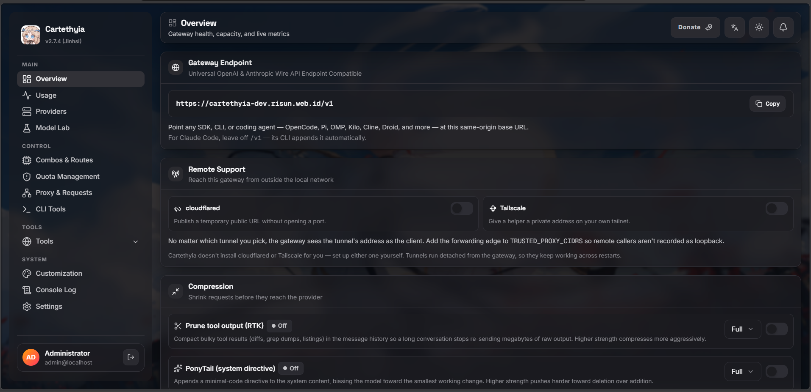
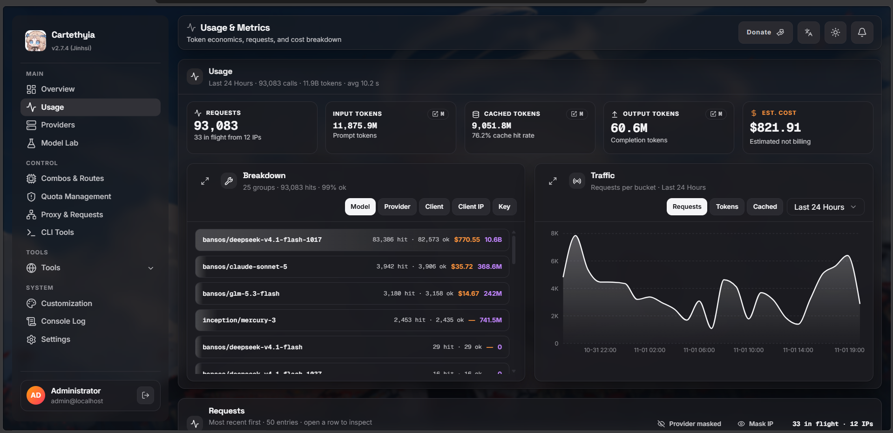
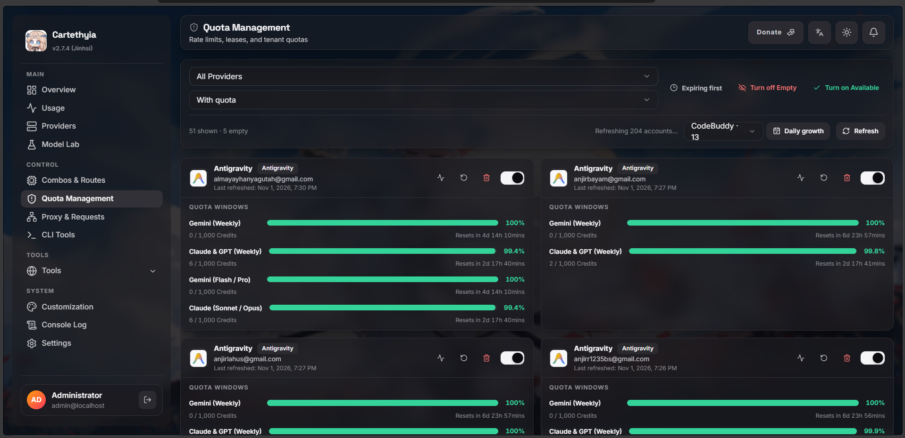
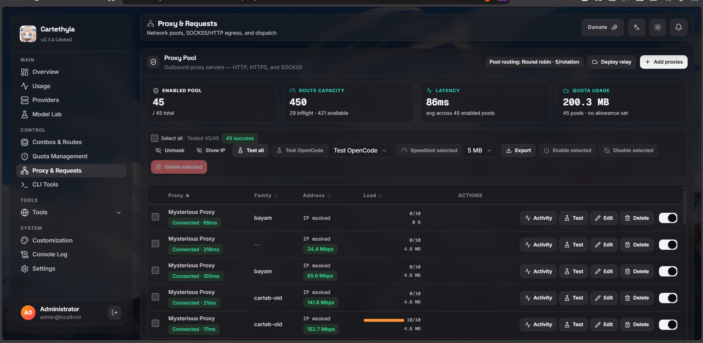
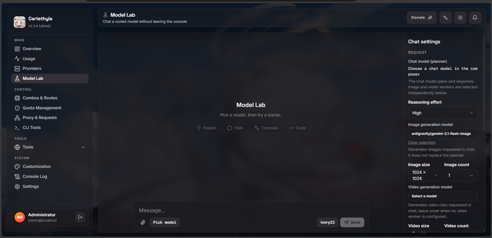
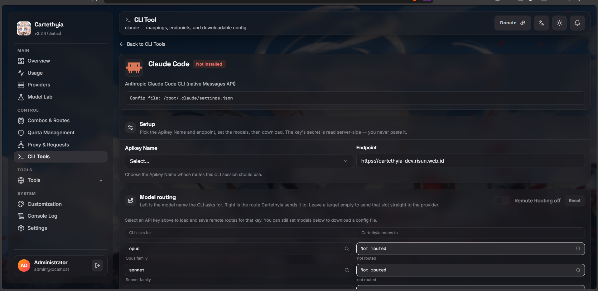
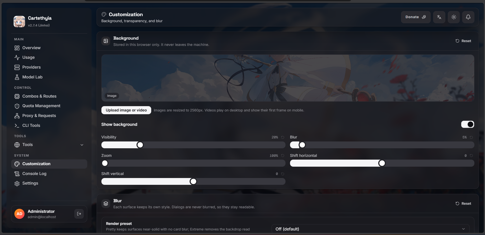

# Cartethyia


**A self-hosted multi-provider AI gateway.**

[](LICENSE)
[](CODE_OF_CONDUCT.md)

Cartethyia gives AI clients one stable, OpenAI and Anthropic-compatible endpoint. Behind it, the gateway handles the operational work: provider-aware translation, account selection, health-aware failover, quota and cooldown enforcement, usage accounting, telemetry, and optional proxy pools.

Configure provider accounts once, issue an API key, and point OpenCode, Droid, Cline, Claude Code, Codex, or any compatible client at Cartethyia. The client keeps its native protocol; Cartethyia normalizes the request, selects a viable route, dispatches upstream, and returns the response in the contract the client expects.

Built with Bun, TypeScript, Elysia, embedded SQLite or external PostgreSQL, and optional Redis coordination.

> **Repository availability**
>
> The original repository (`risunCode/Cartethyia`) was hidden from public view
> by GitHub after automated star activity looked like vote manipulation rather
> than real interest — the project itself is unaffected, and this was not a
> code, security, or licensing issue. The project moved to a reachable
> primary.
>
> Reachable primaries, all carrying the same history and releases:
>
> - **GitHub:** <https://github.com/risunCodex/Cartethyia>
> - **GitLab:** <https://gitlab.com/risuncode/cartethyia>
> - **npm:** <https://www.npmjs.com/package/cartethyia>
>
> Stars and forks are appreciated on the GitHub primary where they can
> actually be counted. The dashboard and console point at this primary; the
> hidden original is kept linked in `dashboard/src/lib/links.ts` as the
> historical alt so a reader who still has access to it is not stranded.

##  Installation

You need Node/npm for installation and **Bun 1.4.0 or newer** to run.

```bash
npm install -g cartethyia
cartethyia setup
carte
```

Install it **globally**. A local `npm install cartethyia` puts `cartethyia` and
`carte` in `./node_modules/.bin/`, which is not on your `PATH` — the commands
will not be found. Either install globally, or run a local one through
`npx cartethyia`.

Update and remove:

```bash
npm update -g cartethyia    # update
npm uninstall -g cartethyia # uninstall
```

Full install guide, modes, Docker, VPS, systemd, and the one-shot script:
[the installation guide](documentation/installation.md). To remove it:
`npm uninstall -g cartethyia`.

##  What it actually does

- **Speaks the provider's own dialect.** Per-provider adapters reproduce the
  client identity, headers, and billing signals the provider expects.
- **Routing looks at health.** Model, alias, combo, capability, account state,
  cooldown, quota, and whether the provider is up — one decision, one plan.
- **A retry still counts.** Failover does not skip admission, usage, quota, or
  telemetry; failures stay distinct instead of collapsing to one 502.
- **You can see the whole hop.** Bounded, redacted capture of what the client
  sent, what Cartethyia translated, what the provider returned, and what the
  client got.

Full list, with the custom-built capabilities and how they differ from plain
forwarders: [Why Cartethyia](documentation/why-cartethyia.md).

##  Showcase

One install, one console: watch traffic land, watch accounts stay healthy,
and change routing without restarting anything.

<table>
<tr>
<td align="center"><br /><b>Overview</b><br /><sub>Gateway endpoint, remote support, and compression</sub></td>
<td align="center"><br /><b>Usage</b><br /><sub>Volume, latency, cached tokens, spend per model</sub></td>
</tr>
<tr>
<td align="center"><br /><b>Quota Management</b><br /><sub>Per-account quota windows, resets, and availability</sub></td>
<td align="center"><br /><b>Proxy &amp; Requests</b><br /><sub>Outbound proxy pools: capacity, latency, and health</sub></td>
</tr>
<tr>
<td align="center"><br /><b>Model Lab</b><br /><sub>Chat a routed model through the real gateway path</sub></td>
<td align="center"><br /><b>CLI Tools</b><br /><sub>Per-CLI model mappings and downloadable config</sub></td>
</tr>
<tr>
<td align="center"><br /><b>Customization</b><br /><sub>Background, transparency, and per-surface blur</sub></td>
</tr>
</table>

##  Routes


| Route                      | For                                       |
| -------------------------- | ----------------------------------------- |
| `/v1/chat/completions`     | OpenAI-style chat                         |
| `/v1/responses`            | Responses API, including Codex tools      |
| `/v1/messages`             | Anthropic Messages, including Claude Code |
| `/v1/models`               | What this key can call                    |
| `/v1/completions`          | Legacy text completions                   |
| `/v1/responses/compact`    | Responses compaction                      |
| `/v1/search`               | Web search                                |
| `/v1/systemone`            | System One                                |
| `/v1/images/generations`   | Image generation                          |
| `/v1/videos/generations`   | Video generation                          |
| `/v1/embeddings`           | Embeddings                                |
| `/v1/audio/transcriptions` | Speech to text                            |
| `/v1/audio/speech`         | Text to speech                            |


Generation routes take an opaque body and let the provider's own adapter shape
it, so what a given model accepts is whatever that provider accepts. Images are
served by Gemini, Antigravity, Codex, and the Buddy family. Video is narrower:
among bundled providers only CodeBuddy and WorkBuddy declare it, via
`seedance-2.5`, submitted as an async task the adapter polls to completion
rather than returning a clip inline. A custom provider is not restricted to
those: any upstream you point it at can serve either route, and the remote's
own error is what comes back if it does not.

Embeddings and both audio routes are **passthrough**: the gateway routes them,
applies admission and accounting, and forwards the body untouched. No bundled
adapter implements them — there is no wire here to translate — so they are
useful against a compatible upstream you configure yourself, and a model row
carrying the matching service kind is all that is needed.

A **custom** provider gets *every* service kind automatically, including these
three: it has no manifest row narrowing it, and you chose its base URL. The
upstream still decides what it actually answers — pointing one at a host that
does not speak a surface gets that host's own error, not a gateway refusal.

The route picks the wire. After that, routing, admission, retry, and accounting
are the same.

##  Lite or Full

Same app either way. Lite is not a cut-down edition.


|          | Pick it when                                                                       |
| -------- | ---------------------------------------------------------------------------------- |
| **Lite** | One person, one machine, or you just want it running                               |
| **Full** | Several people, a VPS, or the process is busy enough that SQLite is the bottleneck |


Docker Compose defaults to Full. A local `.env` defaults to Lite. When Lite
gets tight, export a JSON backup and restore it into Full. You do not rebuild
the config.

Details: [Database modes and configuration](documentation/installation.md#database-modes-and-configuration).

##  Development

From the repository root:

```bash
bun install
bun run dev              # backend with hot reload
bun run typecheck         # backend typecheck
bun run test:backend      # backend suites (Lite + Full modes)
bun run dashboard:typecheck
bun run dashboard:test
bun run dashboard:dev     # dashboard dev server
```

Backend suites live in `test/`, mirroring `src/`; dashboard suites live in
`dashboard/test/`. `bun run test:backend` runs the default backend scope and
also covers `test/cli/` (CLI/installer). The heavier installer lifecycle and
Docker contracts live under `test/integration/` — the Docker contract suite
runs in the default backend scope too, and the full integration scope runs on
request with `bun run test:integration`. Full-mode suites need
`CARTETHYIA_TEST_DATABASE_URL` set (see `documentation/installation.md`); the
suite never touches the runtime `DATABASE_URL`.

##  License

[GNU GPL v3.0 only](LICENSE). You can use, change, and share it. If you ship a
build or a fork, ship the source with it, under the same license. No warranty.

##  Community

- [Contributing](CONTRIBUTING.md) — workflow, code conventions, and pull requests.
- [Code of Conduct](CODE_OF_CONDUCT.md) — expectations for everyone in the community.
- [Security Policy](SECURITY.md) — how to report a vulnerability safely.