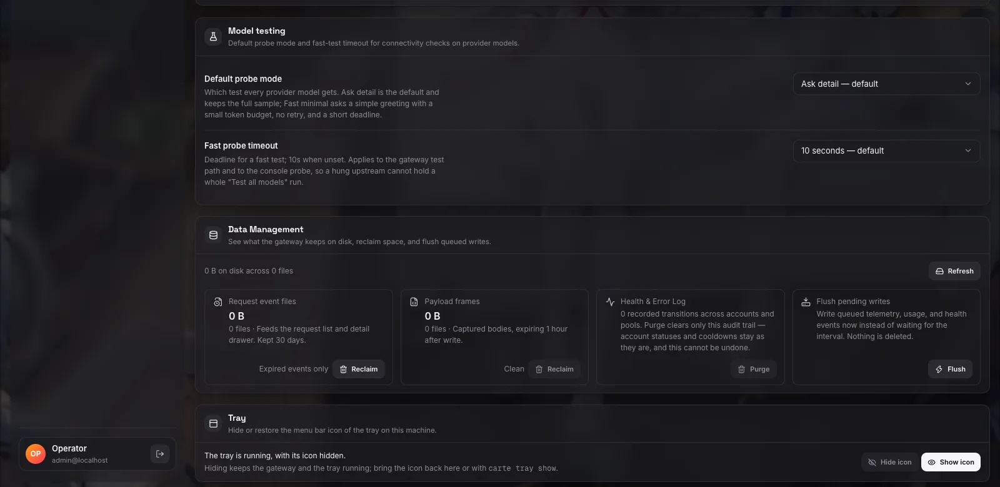

# Tray icon control

A tray-started gateway is normally reached through its menu bar or notification
area icon, and every other way out of that menu stops the gateway: `Exit` stops
it, and killing the helper takes it down too. An operator who wants the gateway
running with a clean menu bar had no option. Hiding the icon now leaves the
gateway and the tray process running, and three surfaces can put the icon back.

Hiding is not stopping. Nothing in this path touches the gateway: it is a
detached process, and the icon belongs to the tray's own surface.

## Surfaces

| Surface | How | Reaches |
|---|---|---|
| CLI | `carte tray hide`, `carte tray show`, `carte tray toggle`, `carte tray status` | a running tray on this machine |
| Second launch | `carte --tray` while a tray already runs | shows the icon instead of failing with "already running" |
| Tray menu | `Hide icon` row | hides only. The menu disappears with the icon, so restoring needs one of the other surfaces |
| Console | `Settings → Tray`, backed by `GET /console/api/tray/status` and `POST /console/api/tray/visibility` | a running tray on the gateway's machine |

The CLI is the reference surface. The console route and the tray menu use the
same channel, so no two surfaces can disagree about what the icon is doing.

## The control channel

Two files in the installation's config directory (mode `0600`), next to
`controller.json`. A socket was not needed: the process that asks is usually not
the tray's parent, and a file needs no port, no handshake, and no dependency.

| File | Written by | Read by | Holds |
|---|---|---|---|
| `tray-request.json` | the caller | the tray's poll loop, every 1 s | `request` (`hide`, `show`, `toggle`), `nonce`, `requestedAt` |
| `tray-state.json` | the tray | any caller | `pid`, `hidden`, `updatedAt`, optional `nonce` |

Writes are atomic (write, then rename), so the tray never reads half a document
and discards a request that was valid.

**The nonce is the confirmation.** A caller writes a request, then waits for a
state record quoting that nonce, up to 3 s at 100 ms intervals. A timestamp
could not do this job: a tray acting inside the same millisecond as the request
would look identical to the state that was already there. `hide` and `show` also
check that the tray ended up in the requested state; `toggle` has no fixed
target, so its nonce alone settles it. A caller that gives up removes its own
request, because a request left behind would act minutes later, long after the
operator was told it failed.

Both files are advisory. A missing, truncated, or hand-edited file reads as
nothing to do and is discarded. A state record whose pid is no longer alive
reads as "no tray running" and is deleted, so no surface reports an icon that is
not there.

## Platform behavior

macOS and Linux use `systray2`, which has no visibility control: hiding ends the
helper process and showing builds a new one. The rows are rebuilt with it,
because the helper numbers them on `ready()` and an update sent with an old row
number rewrites the wrong row. The helper's exit is also how a crash is detected,
so a deliberate hide carries a flag that keeps it from being reported as one.

Windows uses a PowerShell `NotifyIcon` helper that owns a persistent message
loop, so hiding flips `Visible` and the helper stays up. Each change waits for a
`hidden` or `shown` acknowledgement (2 s), and a helper that exits rejects a
pending wait instead of leaving the command hanging.

The Windows and Linux tray paths are implemented and covered by unit tests, but
only the macOS path has been exercised against a real tray.

## Console gates

`POST /console/api/tray/visibility` requires both gates:

- `platform:admin`, because the icon is host state rather than tenant data.
- A loopback peer, because a browser on another machine has no tray to reach.
  Its request would hide an icon the operator there can neither see nor restore.
  An unknown peer is refused: a gate that opens on "cannot tell" is not a gate.

`GET /console/api/tray/status` needs only `platform:admin`, since reading the
state is harmless and the panel needs to explain the local-only rule.

| Response | When |
|---|---|
| `401 unauthorized` / `403 insufficient_scope` | no session, or a session without `platform:admin` |
| `403 tray_control_local_only` | the peer is not loopback, or is unknown |
| `409 tray_not_running` | no live tray recorded on this machine |
| `409 tray_control_unavailable` | the gateway has no config directory to write to |
| `504 tray_visibility_timeout` | the tray did not confirm within 3 s; the request is removed |

Asking for the state the tray is already in is answered from the record without
writing a request, since waking a tray to do nothing would only produce a
failure the operator cannot act on.

## Where to change it

| Concern | File |
|---|---|
| The channel (files, nonce wait, liveness check) | `src/console/tray/control.ts` |
| Console routes and their error mapping | `src/console/tray/routes.ts` |
| Console wire types | `src/console/tray/contracts.ts` |
| CLI commands and the second-launch path | `scripts/cli/tray/commands.ts` |
| `Tray` abstraction, macOS/Linux and Windows implementations | `scripts/cli/tray/index.ts` |
| Windows helper protocol | `scripts/cli/tray/windows.ps1` |
| Command dispatch and help text | `scripts/cli/main.ts` |
| Settings card | `dashboard/src/features/settings/TrayPanel.tsx` |
| Dashboard hooks and poll cadence | `dashboard/src/hooks/tray.ts`, `dashboard/src/data/query-policy.ts` |

Tests: `test/cli/tray-visibility.test.ts`, `test/cli/launcher-tray-subcommand.test.ts`,
`test/console/tray-routes.test.ts`, `dashboard/test/features/tray-panel.test.tsx`.
