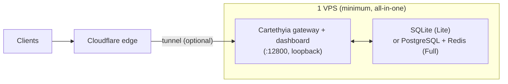

# Deployment — Minimum

The **minimum** deployment is one small VPS running everything: the gateway, the
dashboard, and the database — and, if you choose Full mode, PostgreSQL and Redis
on the same host. This is a supported, complete topology: nothing else is
required to run Cartethyia in production.



---

## 1. Modes

Cartethyia runs either of two database modes (see `CARTETHYIA_DB_MODE`):

| Mode | Database | Coordination | Footprint |
| --- | --- | --- | --- |
| **Lite** | embedded SQLite at `<data-dir>/cartethyia.sqlite` | in-process unless `REDIS_URL` is set | smallest — one process, zero external services |
| **Full** | external PostgreSQL | Redis when `REDIS_URL` is set, else in-memory | heavier — a local PostgreSQL (and optionally Redis) service |

- **Lite** is ideal for a single-process deployment: no service to install or
  patch, and backups are just the SQLite file (plus the data directory).
- **Full** is the recommended production shape when you expect more scale or
  want a separate database host (see [Deployment Security](deployment-security.md)
  for the two-VPS variant). On one VPS, PostgreSQL and Redis run as local
  services — still one machine.

> One schema serves both modes. Migrations are asserted at build/startup; an
> outdated database is rejected rather than silently upgraded in place.

---

## 2. Resource floor

| Resource | Minimum comfortable | Notes |
| --- | --- | --- |
| CPU | 1 vCPU | bursty; mostly I/O-bound |
| RAM | 1–2 GiB | 2 GiB is the reference; swap helps (5 GiB in the reference install) |
| Disk | 10–20 GiB | grows with telemetry payloads; see retention below |
| OS | Debian 12/13 (trixie) | reference install is Debian 13 |

A 1–2 GiB VPS is enough for the minimum deployment. Watch the data directory:
hourly telemetry JSONL and payload frames are pruned by retention
(`CARTETHYIA_TELEMETRY_RETENTION_DAYS`), but a long-running install still grows.

---

## 3. Provisioning (bare metal, Debian)

### 3.1 Baseline packages

```bash
apt update
apt install -y curl git ca-certificates unzip
```

### 3.2 Install Bun (pinned)

The repo pins its Bun version in `.bun-version` (currently **1.4.x**). Use the
official installer and pin the same version:

```bash
curl -fsSL https://bun.sh/install | bash
source /root/.bashrc
bun --version   # must match .bun-version
```

### 3.3 Get the code / package

Either clone the repository (self-hosted source) or install the npm package:

```bash
# Option A — source
git clone https://github.com/risunCodex/Cartethyia.git /opt/cartethyia
cd /opt/cartethyia
bun install --linker isolated --frozen-lockfile
bun run build

# Option B — npm
npm install -g cartethyia@latest
```

### 3.4 Configuration (`.env`)

Create `/opt/cartethyia/.env` (or the config dir your install reads). Minimal
Lite template:

```bash
# /.env
NODE_ENV=production
PORT=12800
CARTETHYIA_DB_MODE=lite
CARTETHYIA_DATA_DIR=/opt/cartethyia/data
CARTETHYIA_PUBLIC_ORIGIN=https://<PUBLIC_DOMAIN>
CARTETHYIA_ENCRYPTION_KEY=<generate-a-secret>
# CARTETHYIA_DRAIN_TOKEN=<generate-a-secret>   # optional, enables graceful /admin/drain
```

Full mode on the same host:

```bash
CARTETHYIA_DB_MODE=full
DATABASE_URL=postgres://<DB_USER>:<DB_PASS>@127.0.0.1:5432/cartethyia
REDIS_URL=redis://:<REDIS_PASS>@127.0.0.1:6379/0
```

> `CARTETHYIA_PUBLIC_ORIGIN` is required and must match the browser-facing
> scheme/host/port. Generate the encryption key once and keep it secret: it
> encrypts stored credentials.

### 3.5 Database (Full mode only)

Install PostgreSQL (+ optional Redis) locally:

```bash
apt install -y postgresql redis-server
systemctl enable --now postgresql redis-server
sudo -u postgres createuser --pwprompt <DB_USER>
sudo -u postgres createdb -O <DB_USER> cartethyia
```

Lite mode needs no database setup at all.

### 3.6 systemd unit

Run the gateway as a service. Example unit (`/etc/systemd/system/cartethyia.service`):

```ini
[Unit]
Description=Cartethyia Gateway
After=network-online.target postgresql.service redis-server.service
Wants=network-online.target

[Service]
WorkingDirectory=/opt/cartethyia
EnvironmentFile=/opt/cartethyia/.env
ExecStart=/root/.bun/bin/bun run src/main.ts
Restart=on-failure
RestartSec=5
# (if you built the standalone binary: ExecStart=/opt/cartethyia/dist/cartethyia)
[Install]
WantedBy=multi-user.target
```

```bash
systemctl daemon-reload
systemctl enable --now cartethyia
```

The first start runs migrations automatically (`ensureMigrated` during boot).

### 3.7 Reverse proxy / tunnel

Bind the gateway to loopback (`127.0.0.1:12800`) and front it with a reverse
proxy or a Cloudflare tunnel. With a Cloudflare tunnel (cloudflared):

```bash
# remote-managed tunnel: the public hostname maps to http://localhost:12800
cloudflared tunnel --token <TUNNEL_TOKEN> run
```

The gateway must **not** be directly internet-exposed; the tunnel (optionally
with Cloudflare WAF/rate limiting) is the public entry point.

---

## 4. Verification

```bash
# From the host
curl -sS http://127.0.0.1:12800/health/ready
# → {"status":"ready","db":"connected"}

# From the public side (through the tunnel)
curl -sS https://<PUBLIC_DOMAIN>/health/ready

# API requires auth (expected 401 without a key)
curl -sS -o /dev/null -w '%{http_code}\n' https://<PUBLIC_DOMAIN>/v1/models
# → 401
```

A `401` on `/v1/models` means the gateway is up and the surface is healthy. The
console should render at `https://<PUBLIC_DOMAIN>/console` (first-boot wizard on
a fresh install).

---

## 5. Day-2 operations

### Updates

```bash
# Source checkout
cd /opt/cartethyia
git fetch origin && git pull --ff-only origin main
bun install --linker isolated --frozen-lockfile
bun run build
systemctl restart cartethyia

# npm-installed
carte update            # detached installer + restart
# or
npm install -g cartethyia@latest --prefer-online
systemctl restart cartethyia
```

If graceful drain matters, set `CARTETHYIA_DRAIN_TOKEN` so the restart drains
in-flight streams (`POST /admin/drain`).

### Backups

| Mode | What to back up | Command |
| --- | --- | --- |
| Lite | SQLite file + data dir | `tar -czf backup.tgz -C /opt/cartethyia data` (ideally on a quiet moment, or use `sqlite3 .backup`) |
| Full | PostgreSQL dump | `pg_dump -Z9 -h 127.0.0.1 -U <DB_USER> cartethyia > backup.sql.gz` |

Back up at least the database and the install id dir; keep backups off the
VPS. Test a restore on a scratch instance before you need it.

### Logs & health

```bash
journalctl -u cartethyia -f
systemctl status cartethyia
curl -sS http://127.0.0.1:12800/health/ready
```

---

## 6. Failure quick reference

| Symptom | First thing to check |
| --- | --- |
| `health/ready` not `ready` | database reachable? (Lite: data dir writable; Full: `DATABASE_URL`/port) |
| Gateway restarting in a loop | `journalctl -u cartethyia -e`; often a missing/mismatched env or failed migration assertion |
| Port 12800 not listening | bind failed (another process?), or service failed to start |
| 502 from tunnel | cloudflared down, or gateway not on loopback 12800 |
| Console/auth issues | `CARTETHYIA_PUBLIC_ORIGIN` mismatch; cookie not valid behind proxy |

---

## 7. Scaling out

When one box is not enough — more traffic, isolation, or resilience — split the
roles across two VPS:

| What | Where |
| --- | --- |
| Gateway, dashboard, tunnel | VPS A (edge) |
| PostgreSQL + PgBouncer + Redis | VPS B (persistence), reachable only over WireGuard |

The two-VPS pattern (gateway + data server) is documented in
[Deployment Security](deployment-security.md), including the WireGuard setup,
connection strings, and DDoS hardening for either topology.
