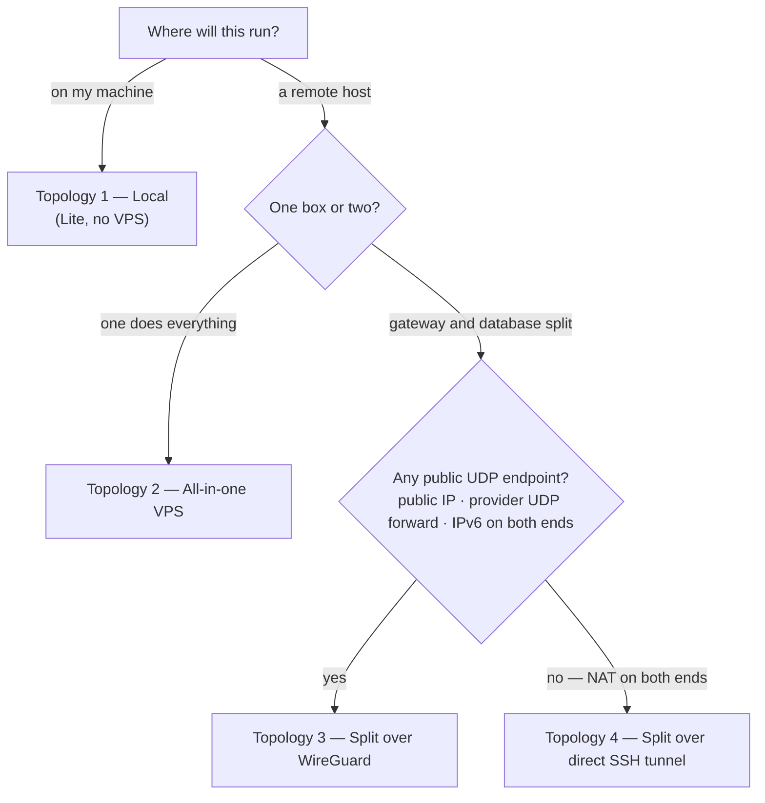
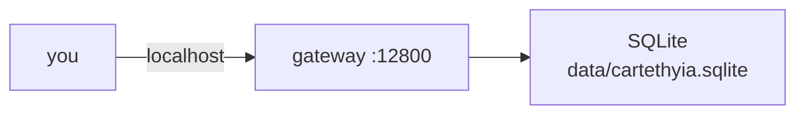
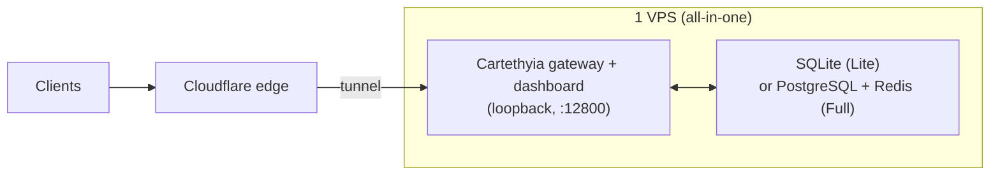
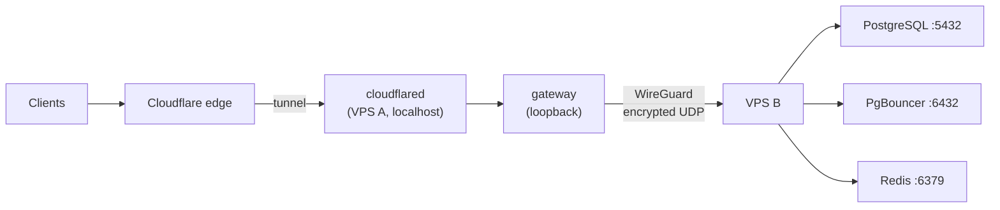
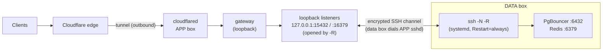

# Deployment

Deploying Cartethyia to a real host: pick the topology that matches your
network situation, provision it, and harden it. The four topologies differ in
where the database lives and how the app reaches it; everything after them —
ingress, security baseline, DDoS hardening, monitoring, backups, Docker —
applies to all of them.

> Placeholders (`<...>`) mark values you must fill with your own addresses,
> domains, and secrets. Never commit real IPs or credentials.

---

## Choose a topology

| # | Topology | When it fits | Database path | Ingress |
| --- | --- | --- | --- | --- |
| 1 | [Local](#topology-1--local-development) | development on your own machine | embedded SQLite (Lite) | `localhost` directly |
| 2 | [Remote, all-in-one](#topology-2--remote-all-in-one-vps) | one VPS with a public IP | local PostgreSQL/Redis (Full) or SQLite (Lite) | Cloudflare tunnel or reverse proxy |
| 3 | [Remote, split — WireGuard](#topology-3--remote-split-over-wireguard) | two VPS, and at least one of them can be reached on a public UDP port | PostgreSQL/Redis over the WireGuard tunnel | Cloudflare tunnel on the edge box |
| 4 | [Remote, split — direct SSH](#topology-4--remote-split-over-a-direct-ssh-tunnel) | two boxes behind NAT with no UDP path at all | PostgreSQL/Redis over a reverse SSH tunnel | Cloudflare tunnel (outbound-only) |

The split topologies (3 and 4) both keep the database off the public internet;
they differ only in the private transport. Rule of thumb: **WireGuard when a
UDP endpoint exists, SSH tunnel when it does not** — both are encrypted,
key-authenticated, and systemd-managed.



---

## Database modes

Cartethyia runs either of two database modes (`CARTETHYIA_DB_MODE`, required):

| Mode | Database | Coordination | Footprint |
| --- | --- | --- | --- |
| **Lite** | embedded SQLite at `<data-dir>/cartethyia.sqlite` | in-process unless `REDIS_URL` is set | smallest — one process, zero external services |
| **Full** | external PostgreSQL | Redis when `REDIS_URL` is set, else in-memory | heavier — a PostgreSQL (and optionally Redis) service |

- **Lite** is ideal for local development and single-process deployments: no
  service to install or patch, and backups are just the SQLite file (plus the
  data directory).
- **Full** is the production shape when you expect scale or want the database
  on its own host (topologies 2–4). On an all-in-one VPS, PostgreSQL and Redis
  run as local services — still one machine.

> One schema serves both modes. Migrations are asserted at build/startup; an
> outdated database is rejected rather than silently upgraded in place. See
> [Persistence parity](development.md#persistence-parity) for how the two
> backends stay aligned.

---

## Resource floor

| Resource | Minimum comfortable | Notes |
| --- | --- | --- |
| CPU | 1 vCPU | bursty; mostly I/O-bound |
| RAM | 1–2 GiB | 2 GiB is the reference. The data server can live on less — 1 GiB runs PostgreSQL + PgBouncer + Redis when tuned. Size swap per the section below |
| Disk | 10–20 GiB | grows with telemetry payloads; see retention (`CARTETHYIA_TELEMETRY_RETENTION_DAYS`) |
| OS | Debian 12/13 | reference install is Debian 12 |

### Swap

Swap is a safety margin, not a performance tier: sized well, it is the
difference between a memory burst riding out and the kernel shooting the
gateway (or worse, PostgreSQL) mid-stream. The reference installs both carry
one — 5 GiB on the 2 GiB app box, 3 GiB on the 1 GiB data server — and
neither has ever been a problem.

| RAM | Recommended swap | Why |
| --- | --- | --- |
| 1 GiB | 3–4 GiB | a PostgreSQL + Redis host has the least headroom; give it room to page cold pages out |
| 2 GiB | 2–5 GiB | gateway bursts (parallel streams) can momentarily double RSS |
| 4 GiB+ | 1–2 GiB | headroom-only; the box rarely touches it |

Rules of thumb and the honest trade-offs:

- **Size it 1.5–2.5× RAM**, capped by spare disk — and keep **≥20% of the
  disk free after the swapfile**: telemetry, packages, and logs still grow.
- **Use a swapfile, not a partition**, on rented VPS: `fallocate` + `mkswap`
  + `swapon` resizes without repartitioning.
- **Swappiness**: the reference data server runs `vm.swappiness=80` — on a
  memory-tight host a higher value parks cold pages out early and keeps the
  hot set resident. Leave the default (60) on comfortable boxes.
- **The trade-off, plainly:** swap lives on your disk, so heavy paging is as
  slow as that disk — on shared NVMe it is unnoticeable in normal operation;
  on very slow storage a hard-swapping host degrades responsiveness before it
  fails. That is the intended behavior: degrade, spill, survive — instead of
  an abrupt OOM kill. RAM first, swap second; the swap you sized right is the
  one you never notice.

---

## Topology 1 — Local development

Everything on your machine. No VPS, no tunnel, no public exposure.

```bash
bun install
# .env at the repo root (or the config dir your install reads):
#   NODE_ENV=development
#   PORT=12800
#   CARTETHYIA_DB_MODE=lite
#   CARTETHYIA_DATA_DIR=./data
#   CARTETHYIA_PUBLIC_ORIGIN=http://localhost:12800
#   CARTETHYIA_ENCRYPTION_KEY=<generate-a-secret>
bun run dev        # or: bun run src/main.ts
curl -sS http://127.0.0.1:12800/health/ready
# → {"status":"ready","db":"connected"}
```

`CARTETHYIA_DB_MODE` is required — never let the mode be guessed: Lite and
Full use different databases and migration sets. Full mode locally points
`DATABASE_URL`/`REDIS_URL` at whatever the machine already provides; check
what is listening before provisioning anything new.



---

## Topology 2 — Remote, all-in-one VPS

One small VPS runs everything: the gateway, the dashboard, and the database
(Lite, or Full with PostgreSQL and Redis on the same host). This is a
supported, complete topology — nothing else is required.



### Baseline packages

```bash
apt update
apt install -y curl git ca-certificates unzip
```

### Install Bun (pinned)

The repo pins its Bun version in `.bun-version`. Use the official installer
and match it:

```bash
curl -fsSL https://bun.sh/install | bash
bun --version   # must match .bun-version
```

### Get the code

Either clone the repository (source run) or install the npm package:

```bash
# Option A — source
git clone https://github.com/risunCodex/Cartethyia.git /opt/cartethyia
cd /opt/cartethyia
bun install --linker isolated --frozen-lockfile
bun run build

# Option B — npm
npm install -g cartethyia@latest
```

### Configuration (`.env`)

Create `/opt/cartethyia/.env`. Minimal Lite template:

```bash
NODE_ENV=production
PORT=12800
CARTETHYIA_BIND_HOST=127.0.0.1
CARTETHYIA_DB_MODE=lite
CARTETHYIA_DATA_DIR=/opt/cartethyia/data
CARTETHYIA_PUBLIC_ORIGIN=https://<PUBLIC_DOMAIN>
CARTETHYIA_ENCRYPTION_KEY=<generate-a-secret>
# CARTETHYIA_DRAIN_TOKEN=<generate-a-secret>   # optional, enables graceful /admin/drain
```

Full mode on the same host adds:

```bash
CARTETHYIA_DB_MODE=full
DATABASE_URL=postgres://<DB_USER>:<DB_PASS>@127.0.0.1:5432/cartethyia
REDIS_URL=redis://:<REDIS_PASS>@127.0.0.1:6379/0
```

> `CARTETHYIA_PUBLIC_ORIGIN` is required and must match the browser-facing
> scheme/host/port. Generate the encryption key once and keep it secret: it
> encrypts stored credentials. `CARTETHYIA_BIND_HOST=127.0.0.1` keeps the
> gateway reachable only through the proxy/tunnel.

### Database (Full mode only)

```bash
apt install -y postgresql redis-server
systemctl enable --now postgresql redis-server
sudo -u postgres createuser --pwprompt <DB_USER>
sudo -u postgres createdb -O <DB_USER> cartethyia
```

Lite mode needs no database setup at all.

### systemd unit

```ini
[Unit]
Description=Cartethyia Gateway
After=network-online.target postgresql.service redis-server.service
Wants=network-online.target

[Service]
WorkingDirectory=/opt/cartethyia
EnvironmentFile=/opt/cartethyia/.env
ExecStart=/root/.bun/bin/bun run src/main.ts
Restart=on-failure
RestartSec=5
# (if you built the standalone binary: ExecStart=/opt/cartethyia/dist/cartethyia)
[Install]
WantedBy=multi-user.target
```

```bash
systemctl daemon-reload
systemctl enable --now cartethyia
```

The first start runs migrations automatically (`ensureMigrated` during boot).

### Verification

```bash
# From the host
curl -sS http://127.0.0.1:12800/health/ready
# → {"status":"ready","db":"connected"}

# From the public side (through the tunnel)
curl -sS https://<PUBLIC_DOMAIN>/health/ready

# API requires auth (expected 401 without a key)
curl -sS -o /dev/null -w '%{http_code}\n' https://<PUBLIC_DOMAIN>/v1/models
# → 401
```

A `401` on `/v1/models` means the gateway is up and the surface is healthy.
The console should render at `https://<PUBLIC_DOMAIN>/console` (first-boot
wizard on a fresh install).

---

## Topology 3 — Remote, split over WireGuard

When one box is not enough — more traffic, isolation, or resilience — split
the roles: the gateway (edge) on one VPS, PostgreSQL + PgBouncer + Redis on a
persistence VPS, with the database reachable only over a WireGuard tunnel.



### When WireGuard works

WireGuard needs a **publicly reachable UDP endpoint on one of the two boxes**:
a public IP, a global IPv6 on both ends, or a UDP port forwarded by the
provider's NAT panel. If neither box can offer that, use
[topology 4](#topology-4--remote-split-over-a-direct-ssh-tunnel).

#### WireGuard prerequisites — read before choosing this topology

Not every VPS can run WireGuard "out of the box". Verify **all** of these
before committing; if any fails, fall back to topology 4 (SSH tunnel) —
outbound TCP always works.

1. **Kernel + tooling on both boxes**
   - Kernel with WireGuard support (`modprobe wireguard` succeeds, or built-in
     on kernel ≥ 5.6) and the `wireguard-tools` package (`wg`, `wg-quick`).
   - `iptables`/`nftables` available if you use `PostUp`/`PostDown` rules
     (NAT/masquerade for forwarded traffic).
2. **A public UDP endpoint on at least one side** — pick one:
   - a public IPv4/IPv6 on the box itself, **or**
   - a provider-side **UDP port forward** (NAT panel) pointing at the box's
     private IP and port 51820, **or**
   - global IPv6 on *both* ends (no NAT).
   - If **both** boxes are behind NAT with no UDP forward and no IPv6, WG
     cannot be established — use topology 4.
3. **Firewall on the listening side** must accept inbound UDP on the chosen
   port (default 51820). On the NAT box, also allow the forwarded port.
4. **PersistentKeepalive = 25** on the dialing side, so the NAT mapping stays
   open. Without it the tunnel silently dies after a few minutes of idle.
5. **MTU**: WG's default 1420 often needs lowering on tunnelled/PPPoE paths
   (symptom: small packets pass, large ones stall). Set `MTU = 1380` (or 1280)
   in both `[Interface]` blocks if you see partial transfers.
6. **IP plan**: pick a dedicated `/24` (e.g. `10.77.0.0/24`) and assign one
   address per box. The DB services bind to the DB box's WG address only —
   never `0.0.0.0`.
7. **Boot persistence**: `systemctl enable --now wg-quick@wg0` on both boxes,
   and keep the service ordered after `network-online.target`.
8. **Cleanup discipline**: when retiring a peer, remove it from `wg0.conf` *and*
   run `wg set wg0 peer <PUBKEY> remove`. Never `wg-quick down` a live interface
   to retire a peer — the DB services bind to its address and every connection
   string breaks.

> Symptom checklist if WG won't come up: `wg show` shows no handshake → UDP
> blocked/not forwarded; handshake OK but no ping → firewall on the DB box
> blocking the WG subnet; ping OK but DB refused → service bound to the wrong
> address or not listening on the WG IP.

### Setup

1. Install `wireguard-tools` on both boxes and generate a keypair on each
   (`wg genkey` / `wg pubkey`). Exchange public keys out of band.
2. On the persistence box (`/etc/wireguard/wg0.conf`):

   ```ini
   [Interface]
   Address = <WG_DB_IP>/24

   [Peer]
   PublicKey = <EDGE_PUBLIC_KEY>
   Endpoint = <EDGE_PUBLIC_ADDR>:51820
   AllowedIPs = <WG_SUBNET>/24
   PersistentKeepalive = 25
   ```

   The peer whose endpoint is publicly reachable listens; the other dials out
   with `PersistentKeepalive` so the NAT mapping stays open. If a NAT provider
   forwards a public UDP port, set `ListenPort` to it and point the peer's
   `Endpoint` at the public address.

3. Bring it up and verify: `systemctl enable --now wg-quick@wg0`, then
   `ping <WG_DB_IP>` from the edge box.

4. The database services bind to the WireGuard interface only (never the
   public internet), and the edge box's connection strings use it:

   ```bash
   DATABASE_URL=postgres://<DB_USER>:<DB_PASS>@<WG_DB_IP>:6432/cartethyia   # PgBouncer, transaction mode
   REDIS_URL=redis://:<REDIS_PASS>@<WG_DB_IP>:6379/0
   ```

5. The edge box's `.env`, gateway service, and ingress follow
   [topology 2](#topology-2--remote-all-in-one-vps); only the database
   connection strings differ.

> After changing the peer list, remove the peer from `wg0.conf` **and** run
> `wg set wg0 peer <PUBLIC_KEY> remove` — and never take the whole interface
> down to retire a peer: the DB services bind to the interface address, so a
> `wg-quick down` breaks every connection string that names it.

---

## Topology 4 — Remote, split over a direct SSH tunnel

The same split as [topology 3](#topology-3--remote-split-over-wireguard) —
gateway here, database there — for networks where **no UDP path exists**: both
boxes behind NAT with no provider UDP forward, and asymmetric IPv6. Outbound
TCP always works, so the private transport is an SSH tunnel instead. Measured
overhead on the reference install (two NAT VPS in the same region): ~0.5 ms
RTT — indistinguishable from a LAN.



### Direction: the data box dials the app box

The tunnel is **initiated by the data box** and lands on the app box's SSH
endpoint, where the client's remote forwards (`-R`) open loopback listeners
the gateway connects to. This direction works everywhere: the side that
cannot accept connections (the NAT data box) only needs outbound TCP, and the
side that accepts (the app box) runs a stock, unmodified sshd.

### Setup

1. **Keypair** — generate it on the data box (the SSH client side); the
   private key never leaves it:

   ```bash
   ssh-keygen -q -t ed25519 -N '' -f /root/.ssh/cartethyia_tunnel_ed25519
   ```

2. **Restricted tunnel user on the app box.** A dedicated account with no
   usable shell, holding the public key with forwarding restrictions:

   ```bash
   useradd -m -s /usr/sbin/nologin -p '*' dbtunnel
   install -d -m 700 -o dbtunnel -g dbtunnel /home/dbtunnel/.ssh
   printf '%s\n' 'no-pty,no-agent-forwarding,no-X11-forwarding ssh-ed25519 <DATA_BOX_PUBLIC_KEY> cartethyia-db-tunnel' \
     > /home/dbtunnel/.ssh/authorized_keys
   chown dbtunnel:dbtunnel /home/dbtunnel/.ssh/authorized_keys
   chmod 600 /home/dbtunnel/.ssh/authorized_keys
   ```

   The `-p '*'` matters: an account with a locked (`!`) password field is
   refused by PAM before pubkey auth is evaluated; `*` is an unusable but
   unlocked password. The shell is `nologin`, so the key can open forwards
   and nothing else.

   > **Quoting gotcha:** value-carrying key options such as
   > `permitlisten="127.0.0.1:15432"` **must be quoted** in
   > `authorized_keys`. The unquoted form (`permitlisten=127.0.0.1:15432`) is
   > rejected by OpenSSH 9.2 as "bad key options" — silently, with no failed
   > -publickey log line, which makes it look like a provider quirk. It is
   > not; quote the value.

3. **systemd unit on the data box** (`/etc/systemd/system/cartethyia-db-tunnel.service`):

   ```ini
   [Unit]
   Description=Cartethyia DB reverse tunnel: app listeners -> data box
   After=network-online.target
   Wants=network-online.target

   [Service]
   Type=simple
   ExecStart=/usr/bin/ssh -N -T -o ServerAliveInterval=15 -o ServerAliveCountMax=3 \
     -o ExitOnForwardFailure=yes -o StrictHostKeyChecking=accept-new -o ConnectTimeout=10 \
     -i /root/.ssh/cartethyia_tunnel_ed25519 -p <APP_SSH_PORT> \
     -R 127.0.0.1:15432:127.0.0.1:6432 \
     -R 127.0.0.1:16379:127.0.0.1:6379 \
     dbtunnel@<APP_PUBLIC_ADDR>
   Restart=always
   RestartSec=5

   [Install]
   WantedBy=multi-user.target
   ```

   The `-R` forwards open `127.0.0.1:15432` and `127.0.0.1:16379` **on the
   app box**, tunneled to the data box's own PgBouncer and Redis. If the data
   services bind to a private interface instead of loopback, target that
   address (e.g. `10.77.0.2:6432` behind WireGuard).

4. **App box `.env`** — the gateway speaks to the loopback listeners:

   ```bash
   DATABASE_URL=postgres://<DB_USER>:<DB_PASS>@127.0.0.1:15432/cartethyia
   REDIS_URL=redis://:<REDIS_PASS>@127.0.0.1:16379/0
   ```

5. Verify, in order:

   ```bash
   systemctl enable --now cartethyia-db-tunnel          # data box
   ss -tln | grep -E ':(15432|16379)'                    # app box: 2 listeners
   ```

   then a real protocol check through the tunnel from the app box (a `select 1`
   via the `pg` driver and a Redis `PING`), then the gateway's
   `/health/ready`.

### Security notes

- The private key sits on the data box and opens nothing but loopback
  forwards; the account cannot log in (`nologin`) and gets no PTY.
- The channel is SSH-encrypted; the database services stay bound to private
  interfaces exactly as in the WireGuard topology.
- Both boxes keep the full [security baseline](#security-baseline) — the app
  box's sshd faces the network, so fail2ban and rate limiting are not
  optional here.
- If a UDP path appears later (provider forward, IPv6 on both ends, a public
  IP), migrate to [WireGuard](#topology-3--remote-split-over-wireguard): flip
  the `.env` connection strings to the tunnel addresses and retire this unit.

## Real-world reference: DUDUL (DB) + PakaiCloud (app) over WireGuard

A concrete, tested instance of [topology 3](#topology-3--remote-split-over-wireguard)
that also illustrates the prerequisites above. Both boxes are NAT VPS products;
WireGuard works because at least one side has a reachable UDP endpoint and the
provider forwards the port.

| Box | Role | Specs | WG IP | Public ingress |
| --- | --- | --- | --- | --- |
| DUDUL | database (PostgreSQL 17 + Redis 8) | 2 GiB RAM, 30 GiB disk | `10.77.0.2/24` | none (DB only) |
| PakaiCloud | app (Cartethyia gateway) | 1 vCPU, 960 MiB RAM | `10.77.0.1/24` | Cloudflare tunnel (outbound) |

- App `.env` (PakaiCloud): `DATABASE_URL=postgres://...@10.77.0.2:6432/cartethyia`,
  `REDIS_URL=redis://:...@10.77.0.2:6379/0` — PgBouncer in transaction mode on `:6432`,
  direct Postgres on `:5432` (kept for admin/migrations only).
- DB services on DUDUL bind to `10.77.0.2` (and `127.0.0.1`) only; the WG
  subnet `10.77.0.0/24` is allowed through the host firewall on ports 5432/6379/6432.
- When fronting Postgres with PgBouncer in transaction mode, set
  `ignore_startup_parameters = extra_float_digits, statement_timeout, lock_timeout,
  idle_in_transaction_session_timeout, application_name, search_path, DateStyle,
  TimeZone, client_encoding, standard_conforming_strings` — the app's `pg` driver
  sends several of these at connect time and PgBouncer rejects them with
  `08P01 unsupported startup parameter` otherwise.
- Cloudflare tunnel runs on the **app** box, origin `http://127.0.0.1:8080`
  (never `localhost` — see [ingress](#ingress-cloudflare-tunnel)).
- Cloudflare tunnel runs on the **app** box, origin `http://127.0.0.1:8080`
  (never `localhost` — see [ingress](#ingress-cloudflare-tunnel)).
- A retired third box (Dahono) was decommissioned as part of this migration:
  app + tunnel stopped and removed, `/opt/cartethyia` deleted, leaving SSH only.

### Migration checklist (old topology 4 → topology 3)

1. **Back up** the data box first (`pg_dump -Fc`, Redis `BGSAVE`); copy the
   dumps off-host.
2. Provision Postgres + Redis on the new DB box; restore core data only
   (truncate telemetry/audit/health/session tables — they are not worth moving).
3. Bring up WireGuard on both boxes, verify `ping <WG_DB_IP>` and a real
   `SELECT 1` / Redis `PING` across the tunnel before touching the app.
4. Install the app on the new app box (clone, `bun install`, build dashboard
   elsewhere and copy `dist/dashboard` if the box is RAM-tight), write `.env`
   with WG addresses, start the service, check `/health/ready`.
5. Move or re-point the Cloudflare tunnel to the new app box; verify public
   `/health/ready` returns 200.
6. **Clean up the old hosts** so nothing runs twice: stop/disable (then delete)
   the old app, tunnel, and data services and remove their unit files; delete
   app directories. Leave SSH for standby access.
7. Enable `wg-quick@wg0` on both boxes for boot persistence.

> If the DB box is RAM-tight, build the dashboard on a larger box and `scp`
> the `dist/dashboard` tarball over — the build needs ~1 GiB peak RSS.

---

## Ingress: Cloudflare tunnel

Every remote topology fronts the gateway with a Cloudflare tunnel (or a
reverse proxy). The gateway binds loopback (`CARTETHYIA_BIND_HOST=127.0.0.1`)
and is never directly internet-exposed.

```bash
cloudflared tunnel --token <TUNNEL_TOKEN> run
```

- Remote-managed tunnel: create it in the Cloudflare dashboard, map the
  public hostname to `http://127.0.0.1:<PORT>`, install the token as
  `/etc/cloudflared/token` (mode 600), and run it as a systemd service.
  **Never write `http://localhost:<PORT>`**: on hosts where `localhost`
  resolves to `::1` first (Debian's `getent hosts localhost` does), an
  IPv4-only loopback bind makes cloudflared dial `[::1]:<PORT>` and every
  request dies with "Unable to reach origin [::1]" (live 2026-11-16).
  Also note the remote dashboard origin wins over a local
  `/etc/cloudflared/config.yml` — fixing only the local config does not
  fix the tunnel.
- TLS terminates at Cloudflare; the origin IP stays hidden; WAF and rate
  limiting are configured at the edge (see
  [DDoS hardening](#ddos-hardening)).

---

## Day-2 operations

### Updates

```bash
# Source checkout
cd /opt/cartethyia
git fetch origin && git pull --ff-only origin main
bun install --linker isolated --frozen-lockfile
bun run build
systemctl restart cartethyia

# npm-installed
carte update            # detached installer + restart
# or
npm install -g cartethyia@latest --prefer-online
systemctl restart cartethyia
```

If graceful drain matters, set `CARTETHYIA_DRAIN_TOKEN` so the restart drains
in-flight streams (`POST /admin/drain`).

### Logs and health

```bash
journalctl -u cartethyia -f
systemctl status cartethyia
curl -sS http://127.0.0.1:12800/health/ready
```

### Failure quick reference

| Symptom | First thing to check |
| --- | --- |
| `health/ready` not `ready` | database reachable? (Lite: data dir writable; Full: `DATABASE_URL`/port, tunnel listeners up in topologies 3–4) |
| Gateway restarting in a loop | `journalctl -u cartethyia -e`; often a missing/mismatched env or failed migration assertion |
| Port not listening | bind failed (another process, or `CARTETHYIA_BIND_HOST` mismatch) |
| 502 from tunnel | cloudflared down, gateway not on loopback, or the tunnel origin says `localhost` while the gateway binds `127.0.0.1` (localhost may resolve to `::1` — use `127.0.0.1` in the Cloudflare dashboard origin) |
| Console/auth issues | `CARTETHYIA_PUBLIC_ORIGIN` mismatch; cookie not valid behind proxy |
| Tunnel listeners missing (topology 4) | data box unit active? `journalctl -u cartethyia-db-tunnel`; key options quoted? |

---

## Security baseline

Applies to every remote topology.

| Threat | Main defense |
| --- | --- |
| DDoS L3/L4 (SYN/connection floods) | Cloudflare edge, kernel (sysctl), firewall rate limiting |
| DDoS L7 (request floods) | Cloudflare rate limiting / WAF, built-in abuse bans, request-body & idle limits |
| Brute-force SSH | fail2ban; key-only auth where the workflow allows |
| Origin IP discovery | all-DNS-proxied, tunnel-only ingress, origin never published |
| Provider/upstream abuse | per-key admission (concurrency/RPM/token budgets), provider max-inflight |
| Credential theft | `CARTETHYIA_ENCRYPTION_KEY` at-rest encryption, key fingerprints, no secrets in docs |
| Application/SSRF | validated outbound fetch, egress pools, loopback bind |

Cartethyia ships protections that require no extra tooling:

| Feature | Behavior |
| --- | --- |
| Loopback binding | `CARTETHYIA_BIND_HOST=127.0.0.1` keeps the gateway reachable only through the proxy/tunnel. |
| `CARTETHYIA_DRAIN_TOKEN` | Enables `POST /admin/drain`, protected by a loopback peer plus this token. Used for graceful shutdown/drain of in-flight streams. Unset disables the route. |
| `CARTETHYIA_PUBLIC_ORIGIN` | Required. Must match the browser-facing scheme/host/port. Keeps the console session cookie secure and valid through the proxy/tunnel. |
| `CARTETHYIA_ENCRYPTION_KEY` | Encrypts stored provider credentials at rest; only fingerprints travel in plaintext. Generate once, keep secret, never rotate casually. |
| `CARTETHYIA_DATA_DIR` | Data directory for SQLite (Lite), payloads, install id. Keep on a persistent volume. |
| `CARTETHYIA_DISABLED_TASKS` | Comma-separated list to disable background tasks (e.g. `zcode-gift-claim`). |
| Request hardening | `maxRequestBodySize` (16 MiB, `CARTETHYIA_SERVER_MAX_BODY_BYTES`) bounds ingress allocation before validation; `idleTimeout` (60s) caps keep-alive abuse / Slowloris. |
| Admission & quota | Per-key concurrency/RPM/token budgets enforced before dispatch; provider max-inflight enforced per account. Rejections are fast (no upstream call). |
| Abuse detection | `src/security/abuse.ts` rate-limits and temporarily bans abusive client addresses on failure patterns, independent of provider health. |
| Console session | Session cookie + CSRF protection; never accepts credentials from the dashboard bundle. |
| SSRF / egress | Outbound fetch is SSRF-validated; egress can be pinned to network pools. |
| Telemetry/content safety | Secrets scrubbed from logs; payload captures are bounded and retention-pruned. |

### The default gateway API key

The first-boot wizard can seed a default gateway key (`CARTETHYIA_API_KEY`).
Treat it as an **admin credential, not a shareable key**. It is created with
the broadest grants: in the console it can edit other API keys — their limits,
scopes, and client-router policies — enable or disable them, and change
routing, pools, and provider settings. Sharing it with a teammate or embedding
it in a client hands them the whole deployment.

Give every consumer their own key instead — the API-key modal creates scoped
keys with per-key concurrency, RPM, and token budgets — and keep the default
key for the operator alone, or disable it once real keys exist. If it leaks,
rotate it and re-issue the consumer keys: a leaked admin key is not something
an audit trail can undo.

---

## DDoS hardening

Defense in depth, edge to host. The edge (Cloudflare) carries the largest
share.

### Cloudflare edge

- Keep all public DNS records **proxied** (grey cloud OFF) so the origin IP
  never leaks. Tunnel ingress makes this structural — there is no origin port
  to find.
- Rate Limiting Rules for `/v1/*` and `/console/*` (e.g. 60 req/min/IP).
- Managed WAF on High; Bot Fight Mode on; Under Attack Mode during an active
  attack.
- IP Access Rules for abusive ASNs/regions if needed.

### Kernel (sysctl)

`/etc/sysctl.d/99-ddos.conf`:

```ini
net.ipv4.tcp_syncookies = 1
net.ipv4.tcp_syn_retries = 3
net.ipv4.tcp_synack_retries = 2
net.ipv4.tcp_max_syn_backlog = 4096
net.core.netdev_max_backlog = 4096
net.core.somaxconn = 4096
net.ipv4.tcp_fin_timeout = 30
net.ipv4.tcp_max_tw_buckets = 16384
net.ipv4.tcp_tw_reuse = 1
net.ipv4.conf.all.rp_filter = 1
net.ipv4.conf.default.rp_filter = 1
net.ipv4.conf.all.accept_source_route = 0
net.ipv4.conf.all.log_martians = 1
net.ipv4.icmp_echo_ignore_broadcasts = 1
net.ipv4.icmp_ignore_bogus_error_responses = 1
net.ipv4.ip_local_port_range = 1024 65535
net.netfilter.nf_conntrack_max = 131072
```

Apply with `sysctl --system`.

### Firewall (nftables)

Default-deny input; the gateway port gets **no accept rule** (loopback traffic
never crosses the input chain of a remote interface, and the tunnel/proxy
connects locally):

```nft
#!/usr/sbin/nft -f
flush ruleset

table inet filter {
  chain input {
    type filter hook input priority 0; policy drop;
    iifname "lo" accept
    ct state established,related accept
    ip protocol icmp accept
    meta l4proto icmpv6 accept
    tcp dport 22 ct state new limit rate 6/minute burst 20 packets accept
    tcp flags & (fin|syn|rst|psh|ack|urg) == (fin|syn|rst|psh|ack|urg) drop
    tcp flags & (fin|syn|rst|psh|ack|urg) == 0x0 drop
  }
  chain forward { type filter hook forward priority 0; policy drop; }
  chain output { type filter hook output priority 0; policy accept; }
}
```

Load with `nft -f /etc/nftables.conf` and persist with
`systemctl enable nftables`. On IPv6-enabled hosts this closes the
often-forgotten second door: a wildcard-bound service is unreachable from
outside, and only SSH remains (rate-limited, and guarded by fail2ban below).
The equivalent iptables `hashlimit`/`connlimit` ruleset works too; pick one
and stay with it.

### Brute-force protection (fail2ban)

```bash
apt install -y fail2ban python3-systemd
```

`/etc/fail2ban/jail.local`:

```ini
[DEFAULT]
bantime  = 1h
findtime = 10m
maxretry = 5
backend  = systemd

[sshd]
enabled = true
```

`backend = systemd` is required on journald-only installs (Debian 12+): the
default log-file backend has no `/var/log/auth.log` to read and the jail dies
quietly. Monitor bans: `fail2ban-client status sshd`.

### SSH hardening

```bash
# /etc/ssh/sshd_config.d/99-hardening.conf
MaxAuthTries 3
MaxSessions 4
LoginGraceTime 30
```

Keep password auth only if key auth is not available for every operator; when
it is, add `PasswordAuthentication no` and `PermitRootLogin prohibit-password`
after the keys are verified. On NAT VPS products, test a key login from the
outside before disabling password auth — and remember that `authorized_keys`
value-carrying options must be quoted (see
[topology 4](#topology-4--remote-split-over-a-direct-ssh-tunnel)).

### Application and patching

- The gateway binds loopback (`CARTETHYIA_BIND_HOST=127.0.0.1`); the firewall
  never publishes the gateway port.
- Keep `CARTETHYIA_DRAIN_TOKEN` set so restarts drain gracefully instead of
  killing in-flight streams.
- Install `unattended-upgrades` and enable it so security updates apply
  automatically.

---

## Monitoring and alerting

| What | How |
| --- | --- |
| Gateway health | `curl http://127.0.0.1:<PORT>/health/ready` (expect `{"status":"ready","db":"connected"}`) |
| Gateway logs | `journalctl -u cartethyia -f` |
| Fail2ban | `fail2ban-client status sshd` → `Currently banned` |
| Firewall drops | `nft list ruleset` counters (look at the drop counter growing) |
| Abuse/rate-limit events | scan `journalctl` for abuse/ban events; check the console error log |
| DB tunnel (topology 4) | `ss -tln | grep -E ':(15432|16379)'` on the app box; unit state on the data box |
| Cloudflare | analytics + security events dashboards (WAF/rate-limit hits) |
| Disk | watch the data dir growth (telemetry retention); alert before 80% |

Low-cost setup on a small box: a daily `logwatch`/mail summary plus a cron
that greps `fail2ban-client status sshd` and `health/ready`. Avoid heavy
agents (need netdata only if you have headroom).

---

## Incident response (mini runbook)

1. **Confirm it is an attack** — `journalctl -u cartethyia -e | tail`,
   firewall drop counters, Cloudflare analytics. Look for one source IP/ASN
   dominating, or SYN/conn counters spiking.
2. **Lock the edge** — enable Cloudflare **Under Attack Mode**, tighten rate
   limiting, add an IP Access Rule for the offending ASN/region.
3. **If origin is being hit directly** — check nothing forwards to the
   gateway port except the tunnel; verify the proxy only listens on loopback;
   if the origin IP leaked, change it (new VPS IP / re-proxy all DNS).
4. **At host level** — the firewall rate limits are already working; verify
   counters and persist any manual ban (`nft add element` / the equivalent
   ipset).
5. **SSH brute-force** — confirm `fail2ban` bans; if needed raise `bantime`
   or reduce `maxretry`.
6. **Aftermath** — note the timeline, which controls fired, and add the source
   IP/ASN to the Cloudflare block list permanently if it keeps coming back.

---

## Backups and recovery

| Mode | What to back up | Command |
| --- | --- | --- |
| Lite | SQLite file + data dir | `tar -czf backup.tgz -C /opt/cartethyia data` (or `sqlite3 .backup`) |
| Full | PostgreSQL dump | `pg_dump -Z9 -h 127.0.0.1 -U <DB_USER> cartethyia > backup.sql.gz` |

- Keep backups **off the VPS** (object storage / another machine), encrypted.
- Include the `.env` (or at least the non-secret parts) in your runbook; the
  encryption key must be recoverable or stored credentials cannot be read
  after a restore.
- Test a restore on a scratch instance before an incident.

---

## Docker deployment

### Image

The repository ships a `Dockerfile`:

- **Builder:** `oven/bun:1.4.2-debian` (pinned to `.bun-version`), runs
  `bun install --frozen-lockfile`, dashboard build, then AOT + standalone binary.
- **Runtime:** `debian:12-slim`, runs as non-root `uid 10001`
  (dropped via `setpriv`), with `HEALTHCHECK` on `/health/ready` dialed via
  `127.0.0.1` — not `localhost`, which can resolve to `::1` first and
  dead-dial an IPv4-only bind.
- **Exposes** `12800`, `STOPSIGNAL SIGTERM`, entrypoint repairs volume ownership
  then drops privileges.

### Compose

`docker-compose.yml` provides:

- `app` service: builds the image, `env_file` from `.env`, persistent volume
  `cartethyia-data:/app/data`, depends on `redis`, `restart: unless-stopped`.
  The gateway port publishes on **host loopback by default**
  (`127.0.0.1:<PORT>`); set `CARTETHYIA_PUBLISH_HOST` to widen it only when
  the host is not already fronted by a tunnel or reverse proxy. The app's
  in-container bind is pinned to `0.0.0.0` in `environment:` — docker-proxy
  reaches the container over its own IP, and `environment:` overrides
  `env_file:`, so a host `.env` carrying `CARTETHYIA_BIND_HOST=127.0.0.1`
  cannot silently break the published port.
- `redis` service: `redis:7.4.2-alpine`, **bound to `127.0.0.1:6379`** on the
  host, with a healthcheck.
- `pgbouncer` service: opt-in under the `full` profile
  (`docker compose --profile full up`), transaction mode, server pool capped at
  12 (`DEFAULT_POOL_SIZE`); without the profile it does not start.
- PostgreSQL is never bundled; Full mode reaches it via `DATABASE_URL`.

### Hardening beyond the defaults

```yaml
services:
  app:
    # Loopback publish is already the default; shown for emphasis. Override
    # with CARTETHYIA_PUBLISH_HOST only when no tunnel/proxy fronts the host.
    ports:
      - "127.0.0.1:12800:12800"
    security_opt:
      - no-new-privileges:true
    cap_drop:
      - ALL
    read_only: true
    tmpfs:
      - /tmp
    mem_limit: 1g
    pids_limit: 256
    restart: unless-stopped
```

Notes:

- The image already drops to `uid 10001`; add `no-new-privileges` and drop all
  capabilities for defense in depth.
- `read_only: true` needs a tmpfs for `/tmp` (and the data volume mounted
  read-write).
- Resource limits (`mem_limit`, `pids_limit`) bound runaway usage.
- Store `.env` and volume data outside the image; keep them out of the image and
  git history.
